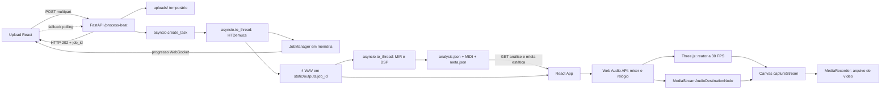

# Trap AI Studio

> Aplicação local de análise e produção musical assistida por IA para engenharia reversa de beats de trap.

   

## Visão geral

O Trap AI Studio recebe um beat em WAV ou MP3 e transforma a mixagem estéreo em material explorável: quatro stems, metadados MIR, eventos de notas exportáveis como MIDI, detecção de ataques de bateria e envelopes de energia para visualização. O objetivo é apoiar estudo, remix e produção musical; separação e transcrição são estimativas computacionais e podem conter artefatos ou erros.

O MVP implementado inclui:

- Separação em quatro stems: bateria, baixo (usado como aproximação para 808), outros/melodia e vocais.
- Estimativa de BPM e tonalidade maior/menor.
- Transcrição de melodia, baixo e vocais em arquivos MIDI; o caminho Basic Pitch pode carregar curvas de pitch bend, e há fallback monofônico pYIN.
- Detecção de kicks, snares/claps e hi-hats usando bandas filtradas e ataques.
- Mixer de quatro canais no navegador com volume, mute, solo, loop, busca e controles de reprodução.
- Reator visual Three.js sincronizado a envelopes pré-computados a 30 amostras/segundo.
- Acompanhamento de jobs assíncronos por WebSocket, com polling HTTP como fallback, biblioteca local e gravação do canvas com áudio mixado em tempo real.

> **Escopo fiel ao código:** o repositório integra modelos pré-treinados e algoritmos de bibliotecas; não contém código nem dataset de treinamento. A separação de frequências não identifica instrumentos semanticamente: “bass” não garante ser exclusivamente 808. A captura de vídeo depende das APIs e formatos suportados pelo navegador.

## Arquitetura e fluxo de dados



`POST /process-beat` salva temporariamente o upload e cria um job. O pipeline é encadeado, mas ambas as etapas pesadas são executadas em threads via `asyncio.to_thread`, evitando bloquear o event loop: Demucs separa os stems; `analyze_stems` estima metadados, transcreve, detecta bateria e calcula envelopes. `JobManager` mantém progresso e conexões em memória; callbacks enviados durante o trabalho são programados no loop principal. Os arquivos persistem em `static/outputs/{job_id}/`, enquanto o estado de jobs não é persistente. O cliente recebe progresso pelo WebSocket e pode consultar o endpoint HTTP de status.

No cliente, os quatro stems são carregados como elementos de áudio e conectados a nós de ganho do Web Audio API. O relógio de reprodução guia o reator e o piano roll; envelopes com passo de 1/30 s fornecem os valores de animação. Para gravação, o canvas usa `captureStream(30)` e o áudio mixado usa `MediaStreamAudioDestinationNode`, combinados em `MediaRecorder`.

### Estrutura real do repositório

```text
.
├── main.py                         # Cria FastAPI, CORS, lifespan, /static e /health
├── requirements.txt                # Dependências Python
├── routes/
│   └── audio.py                    # Upload, pipeline, WebSocket, biblioteca e análise
├── services/
│   ├── demucs_service.py           # Leitura, reamostragem, inferência e stems WAV
│   ├── job_manager.py              # Estado de jobs e broadcast WebSocket
│   └── music_analyzer.py            # BPM, tonalidade, AMT, DSP, MIDI e envelopes
├── static/outputs/                 # Artefatos por job (criados em execução)
├── uploads/                        # Upload temporário (criado em execução)
└── frontend/
    ├── package.json                # Scripts e dependências do Vite/React
    ├── package-lock.json           # Resolução travada de dependências JS
    ├── vite.config.ts              # Vite na porta 5173
    └── src/
        ├── main.tsx                # Montagem do React
        ├── App.tsx                 # Estado da aplicação e composição da interface
        ├── types.ts                # Contratos TypeScript
        ├── index.css               # Estilos globais
        ├── hooks/useStemAudio.ts   # Sincronização e mixagem Web Audio
        └── components/
            ├── UploadArea.tsx       # Upload, progresso WS e polling
            ├── VisualReactor3D.tsx # Three.js e gravação de áudio/vídeo
            ├── StemMixer.tsx       # Controles por stem e downloads
            ├── PianoRollCanvas.tsx # Notas, pitch bend e grade de bateria
            ├── PlayerControls.tsx  # Transporte, seek e loop
            ├── BeatLibraryModal.tsx# Lista e seleção da biblioteca
            └── Header.tsx          # Cabeçalho, metadados e ações
```

## Fundamentação de IA, MIR e DSP

### Separação de fontes: HTDemucs

O serviço carrega `htdemucs` através de `demucs.pretrained.get_model`, põe o modelo em modo de avaliação e guarda uma instância por dispositivo em cache. O modelo é pré-treinado; este projeto não o treina nem ajusta seus pesos. A arquitetura HTDemucs combina dois caminhos tipo U-Net: um processa waveform com convoluções temporais e o outro processa uma representação espectral baseada em STFT. As representações são alinhadas e combinadas em níveis internos; blocos Transformer no gargalo usam atenção intra-domínio e cruzada entre os domínios temporal e espectral. As saídas são estimativas dos quatro alvos instrumentais.

O treinamento original é supervisionado com misturas e fontes isoladas alinhadas. MUSDB18-HQ e músicas adicionais aparecem no treinamento descrito pelos autores, mas os pesos usados aqui vêm do pacote Demucs, sem treinamento local. A documentação do modelo caracteriza a perda no domínio temporal; não se deve inferir deste repositório uma combinação de L1 e Multi-Resolution STFT Loss específica, pois ele apenas executa os pesos publicados. Na inferência, `apply_model` é chamado com um tensor de áudio e faz o tratamento de segmentos/overlap aplicável à implementação Demucs; o serviço não programa um overlap-add próprio.

O áudio é lido por `soundfile`, convertido para float32, ajustado para estéreo e 44,1 kHz, então enviado ao dispositivo disponível (CUDA com pelo menos 6 GB detectados; caso contrário CPU). A reamostragem no serviço é interpolação linear PyTorch. Limite configurado: 600 segundos. Os stems são WAV PCM 16-bit. A ordem/model labels usados pelo serviço são `drums`, `bass`, `other`, `vocals`.

### Transcrição automática: Basic Pitch e pYIN

A transcrição tenta importar `basic_pitch.inference.predict` e executá-lo separadamente nos stems de melodia, baixo e vocais. Basic Pitch é uma rede leve de AMT desenvolvida pelo Spotify Audio Intelligence Lab. Sua arquitetura calcula uma CQT log-normalizada, aplica Harmonic Stacking para reunir evidência de parciais harmônicos e usa cabeças convolucionais que predizem contornos multipitch, onsets e ativações de notas/frames. A inferência converte ativações em eventos com início, fim e velocidade; as curvas de contorno podem informar pitch bends. As notas e bends são serializados por `pretty_midi`.

Os pesos do Basic Pitch são pré-treinados; não há treinamento no projeto. O wrapper `predict` e a conversão de eventos fornecem curvas de bend quando disponíveis. Se importação ou inferência falhar, o serviço registra o erro e recorre a `librosa.pyin`: estimativa probabilística de F0 baseada na periodicidade/autocorrelação, com inferência temporal por um modelo de estados ocultos. O fallback é monofônico por segmento e calcula variações intra-nota para bends aproximados; não equivale à transcrição polifônica do Basic Pitch. Assim, o resultado de 808 com glide depende do stem e do método que efetivamente conseguiu executar.

### MIR e processamento digital de sinais

- **BPM:** `librosa.beat.beat_track` calcula força de onset/envelope rítmico e escolhe uma sequência de batidas por programação dinâmica. O serviço usa o stem de bateria e reporta o tempo estimado.
- **Tonalidade:** `librosa.feature.chroma_cqt` agrega energia nas 12 classes de altura. O vetor médio é correlacionado com perfis maior e menor de Krumhansl-Kessler, rotacionados pelas 12 tônicas candidatas. É uma estimativa global, não uma análise harmônica por seção.
- **Bateria:** filtros Butterworth passa-banda de ordem 4 (implementados em SOS com `scipy.signal`) isolam 20–150 Hz (kick), 150–3000 Hz (snare/clap) e 3000–16000 Hz (hi-hat). RMS/envelope e limiar de transiente geram tempos e intensidades. São classes aproximadas por banda, sujeitas a sobreposição espectral; o topo é limitado pela Nyquist do sinal de análise.
- **Envelopes visuais:** energia RMS de cada stem é agregada em saltos de `sr // 30` amostras a 22.050 Hz e normalizada para produzir aproximadamente 30 valores por segundo. Eles dirigem a animação; não são uma análise de vídeo nem uma detecção de eventos aprendida.

## Decisões de engenharia e limitações

- **I/O de áudio no Windows:** `demucs_service.py` usa `soundfile`/libsndfile em vez das rotinas de leitura/escrita do torchaudio, e reamostra com interpolação linear PyTorch. Isso evita depender de determinados caminhos de codecs/DLLs do FFmpeg no I/O do projeto. `torchaudio` ainda consta em `requirements.txt` como dependência, portanto a substituição não remove completamente o pacote do ambiente.
- **Responsividade:** `asyncio.to_thread` move inferência/análise CPU-bound para threads; `JobManager` permite enviar progresso via loop de eventos. É processamento assíncrono dentro de uma única instância de servidor, não uma fila distribuída: jobs em execução e conexões se perdem ao reiniciar, e não há controle de concorrência persistente.
- **Sincronização e gravação:** os stems usam um `AudioContext` compartilhado, ganhos individuais e um destino de stream para gravação. O canvas habilita `preserveDrawingBuffer` e fornece stream de vídeo a 30 FPS. A captura do áudio/vídeo ocorre no cliente; o formato final depende do suporte de `MediaRecorder` do navegador.
- **Persistência:** arquivos gerados ficam no disco local e são servidos estaticamente. A biblioteca é reconstruída lendo metadados em disco; não há banco de dados.
- **CORS e endereços:** o frontend define backend `http://localhost:8000` e WebSocket `ws://localhost:8000`; a configuração CORS inclui wildcard e credenciais, adequada apenas para desenvolvimento local, devendo ser restringida antes de expor o serviço.

## Stack e versões

Versões fixas são as que aparecem com `==`; especificadores `>=` não travam uma versão única. O `package-lock.json` resolve as faixas JS.

| Camada | Biblioteca | Versão declarada | Papel |
|---|---|---:|---|
| Backend | FastAPI | 0.115.5 | API REST e WebSocket |
| Backend | Uvicorn | 0.32.1 | Servidor ASGI |
| Backend | PyTorch | >=2.1.0 | Inferência e reamostragem |
| Backend | Demucs | >=4.0.1 | Separação de fontes |
| Backend | soundfile | >=0.12.1 | Leitura e gravação WAV |
| Backend | librosa | >=0.10.1 | MIR, reamostragem e pYIN |
| Backend | SciPy | >=1.11.0 | Filtros Butterworth |
| Backend | pretty_midi | >=0.2.10 | Escrita dos arquivos MIDI |
| Backend | basic-pitch | >=0.3.0 | AMT principal opcional em runtime |
| Frontend | React / React DOM | ^18.3.1 | Interface |
| Frontend | Three.js | ^0.170.0 | Reator visual WebGL |
| Frontend | Vite | ^5.4.11 | Servidor e build |
| Frontend | TypeScript | ^5.6.3 | Tipagem e compilação |
| Frontend | Tailwind CSS | ^3.4.15 | Estilos utilitários |
| Frontend | lucide-react | ^1.16.0 | Ícones |

## Referência da API

Todos os endpoints de áudio usam prefixo `/api/v1`.

| Método | Caminho | Descrição |
|---|---|---|
| `POST` | `/api/v1/process-beat` | Recebe `multipart/form-data` (`file`, `.mp3`/`.wav`, até 100 MB), cria job e retorna HTTP 202 com `job_id`, `status` e mensagem. |
| `GET` | `/api/v1/analysis/{job_id}` | Retorna o JSON completo da análise persistido no diretório do job; 404 se não houver arquivo. |
| `GET` | `/api/v1/jobs/{job_id}` | Estado, percentual, etapa, mensagem, resultado ou erro. Se necessário reconstrói estado concluído a partir dos arquivos. |
| `GET` | `/api/v1/beats` | Lista beats com metadados, caminhos de stems, MIDI e URL de análise a partir dos diretórios locais. |
| `DELETE` | `/api/v1/beats/{job_id}` | Remove os artefatos locais daquele job. |
| `GET` | `/health` | Verificação simples; retorna `{"status":"ok","service":"Trap AI Studio"}`. |
| `WS` | `/api/v1/ws/{job_id}` | Envia estado atual ao conectar e atualizações de progresso até conclusão/falha. |

Os arquivos de áudio, MIDI e análise são servidos pelo mount `/static`, por exemplo `/static/outputs/{job_id}/drums.wav`, `analysis.json` ou `midi/bass_808.mid`. O job manager é memória volátil; para cliente sem WebSocket, consulte `GET /jobs/{job_id}` periodicamente.

## Instalação e execução local

Requer Python 3.10 recomendado e Node.js com npm. No PowerShell, a partir da raiz:

```powershell
py -3.10 -m venv venv
.\venv\Scripts\Activate.ps1
python -m pip install --upgrade pip
```

Instale o PyTorch com os wheels CPU oficiais antes das demais dependências, evitando resolução de wheel CUDA:

```powershell
pip install torch torchaudio --index-url https://download.pytorch.org/whl/cpu
pip install -r requirements.txt
```

O `requirements.txt` já declara `torch` e `torchaudio`; a instalação anterior escolhe as builds CPU, e o segundo comando instala/respeita os demais requisitos. Em ambientes onde o índice extra é preferido em vez de exclusivo, use `--extra-index-url https://download.pytorch.org/whl/cpu` no comando PyTorch, verificando que a resolução selecionou as builds CPU.

Em um terminal com o ambiente Python ativado, inicie a API:

```powershell
uvicorn main:app --reload --host 0.0.0.0 --port 8000
```

Em outro terminal, instale e inicie o frontend:

```powershell
cd frontend
npm install
npm run dev
```

Abra `http://localhost:5173`. A API fica em `http://localhost:8000`, documentação interativa em `/docs` e health check em `/health`. O primeiro processamento pode demorar: Demucs baixa os pesos pré-treinados ao primeiro uso, e inferência em CPU é custosa. Os diretórios `uploads/` e `static/outputs/` são criados pelo backend. Para produção, configure origens CORS e URLs do frontend conforme o ambiente e planeje limites de concorrência, armazenamento e limpeza de resultados.

## Referências técnicas

- [Demucs: implementação oficial HTDemucs](https://github.com/facebookresearch/demucs/blob/main/demucs/htdemucs.py) e [artigo Hybrid Transformers for Music Source Separation](https://arxiv.org/abs/2211.08553).
- [Basic Pitch: implementação oficial do modelo](https://github.com/spotify/basic-pitch/blob/main/basic_pitch/models.py) e [artigo de AMT](https://arxiv.org/abs/2203.09893).
- Implementação da análise e processamento usados neste projeto: `services/music_analyzer.py` e `services/demucs_service.py`.
